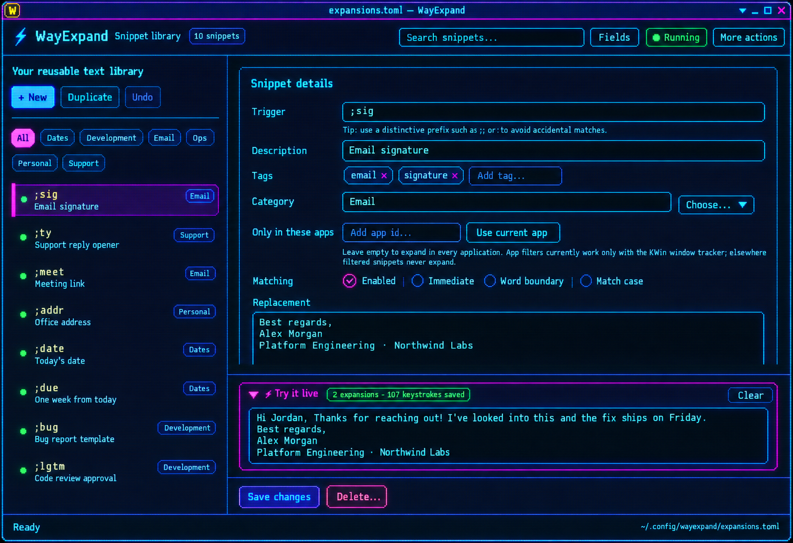
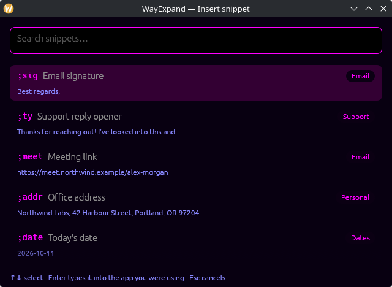
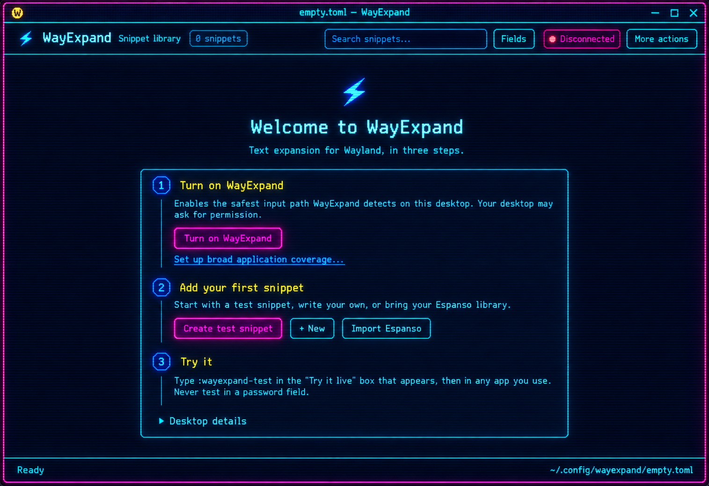

# WayExpand

[](https://github.com/cyberducttape/wayexpand/actions/workflows/ci.yml)
[](https://github.com/cyberducttape/wayexpand/releases)
[](LICENSE)
[](https://www.rust-lang.org/)

## Type less. Keep your words local.

**WayExpand is a text expander built for Wayland.** Type `;sig` and get your
signature. Type `;ty` and get your support reply — with the cursor waiting
where you need to keep typing. Dates, addresses, templates, team snippets:
local, offline, no account, no telemetry.



### What makes it different

- **See it work before you set anything up.** The *Matcher preview* panel
  expands your saved snippets as you type with the daemon's own matching
  engine — no daemon, permission, or desktop integration needed — and counts
  the keystrokes you saved. It does not exercise desktop capture or insertion;
  `wayexpand doctor` covers that.
- **Quick-insert picker.** Bind `wayexpand-gui --picker` to a keyboard
  shortcut. Type a few letters, press Enter, and the running WayExpand service
  types the snippet into the app you were using. Typing needs focused-window
  tracking (currently KDE Plasma); elsewhere, or without the service, Enter
  copies it to the clipboard. No trigger to remember.

  

- **Whole config files, filled in.** `wayexpand new playbook` asks for the
  host group and package and writes a ready Ansible playbook. Dockerfiles,
  Compose, Kubernetes, systemd units, nginx, and CI workflows are built in,
  and your own templates work the same way.
- **One click to turn on.** The first-run screen detects your desktop and
  enables the safest input path it finds. It never grants raw keyboard access
  on its own.
- **Safe by design.** Matching pauses in password fields when the desktop
  reports them, app-specific snippets fail closed, command snippets run
  without a shell under timeouts and output limits, and errors never echo your
  snippet text.
- **Brings your library along.** Import Espanso YAML, edit in the GUI, the
  terminal UI, or plain TOML, and roll out team snippets with fleet policy.

### Project status at a glance

| Area | Current status |
| --- | --- |
| Configuration, CLI, and JSON contracts | Stable and regression-tested |
| Linux architectures | x86_64 and aarch64 build paths |
| Desktop integration | Wayland backends available; compositor support varies |
| Production certification | Run `wayexpand doctor`; see the [support matrix](docs/SUPPORT_MATRIX.md) |
| Distribution packages | Experimental (uncertified) `.deb`, `.rpm`, and archives on the release page; certified releases pending |

## Install

### Prebuilt packages (experimental)

Uncertified builds are published as GitHub prereleases named
*Experimental build …* on the [releases page](https://github.com/cyberducttape/wayexpand/releases).
They pass the full CI suite but not real-desktop certification, and need no
Rust toolchain. Each includes x86_64 and aarch64 archives, a `.deb`, and an
`.rpm`, with `.sha256` files and build provenance:

```sh
sha256sum --check wayexpand-*-linux-x86_64.tar.gz.sha256
tar -xzf wayexpand-*-linux-x86_64.tar.gz
./wayexpand-*-linux-x86_64/scripts/install-release.sh
# or: sudo apt install ./wayexpand_*_amd64.deb
# or: sudo dnf install ./wayexpand-*.x86_64.rpm
```

### From source

Rust 1.95 or newer:

```sh
git clone https://github.com/cyberducttape/wayexpand
cd wayexpand
./scripts/install-user.sh
wayexpand-gui
```

The installers never run as root, enable services, grant raw-input access, or
accept portal consent for you. [Packaging](docs/PACKAGING.md) covers distro
packages and the Ubuntu PPA's status.

## Your first minute



1. **Turn on WayExpand** — one click in the GUI, or `wayexpand setup` in a
   terminal.
2. **Add a snippet** — *Create test snippet*, write your own, or import Espanso.
3. **Try it** — type the trigger in *Matcher preview*, then in a normal text
   field in an app you use. Check *Desktop details* for the capabilities and
   certification status of the active integration.

Set up the picker by adding a desktop shortcut (for example <kbd>Super</kbd> +
<kbd>.</kbd>) that runs `wayexpand-gui --picker`. Scripts can do the same with
`wayexpand insert ';sig'`.

Useful commands:

```sh
wayexpand doctor          # what this desktop supports, and what is missing
wayexpand status          # is the daemon running, and on which path
wayexpand upgrade-status  # is the running daemon from this CLI build?
wayexpand test ';sig'     # check matching without the desktop
```

## Generate config files

Any snippet with an `output_file` is a file template. `wayexpand new` lists
them, asks for each `{{field:…}}` (in the terminal, or a form with `--gui`),
and writes the file without overwriting one that exists:

```console
$ wayexpand new compose --set service=web
Wrote compose.yaml
$ cat compose.yaml
services:
  web:
    image: nginx:stable
    restart: unless-stopped
    ports:
      - "8080:80"
    ...
```

Built in: `dockerfile` (plus `-python`, `-node`, `-rust`), `compose`,
`playbook`, `ansible-role`, `inventory`, `systemd-service`,
`github-actions`, `nginx-site`, and `k8s-deployment`. Start your own from
`wayexpand new --show playbook`. Jinja and GitHub `{{ … }}` expressions are
written as `{{{{ … }}}}`. See [Templates](docs/TEMPLATES.md).

## Desktop compatibility

- **Committed text only.** WayExpand does not see IME preedit/composition;
  finish CJK, dead-key, and Compose sequences before expecting a trigger to
  match.
- **App-specific snippets** need focused-window tracking, currently available
  only on KDE Plasma (KWin). Elsewhere they fail closed and never expand.
- **No compositor is certified yet** by automated end-to-end tests. Run
  `wayexpand doctor` on your own session before relying on a backend.
- **evdev is a last resort.** It observes every keyboard event, including
  password fields, so setup never grants keyboard-device access and
  keystroke routes keep typed expansions off until you allow them with
  `compatibility_mode`. Recommended mode configures the highest-ranked route
  that is available and allowed by policy: certified routes first, then
  input-method-v2 (when libei key pass-through is available), then IBus; it
  never automatically selects evdev or another globally observing path. See
  [Insertion guarantees](SECURITY.md#insertion-guarantees).

The [support matrix](docs/SUPPORT_MATRIX.md) and
[certification matrix](docs/CERTIFICATION_MATRIX.md) list evidence and known
limits; deployment teams should also use the
[production acceptance checklist](docs/PRODUCTION_ACCEPTANCE_CHECKLIST.md).

## Security

WayExpand runs as the unprivileged desktop user, works offline, has no
telemetry, and owner-checks its configuration files. Command snippets run
without a shell, with bounded queues, output limits, timeouts, and process
group cleanup; organization policy can audit or enforce restrictions. These
controls make everyday operation predictable — WayExpand does not claim to be
a security sandbox. See [SECURITY.md](SECURITY.md) and the
[threat model](THREAT_MODEL.md).

## Migrating from Espanso

```sh
wayexpand import espanso ~/.config/espanso/match/base.yml > imported.toml
```

`--strict` rejects entries whose Espanso semantics cannot be preserved, and
`--report-json` writes a machine-readable migration report to stderr. The
GUI's import merges by default and previews duplicates and conflicts before
anything changes. See [Migrating from Espanso](docs/MIGRATION_FROM_ESPANSO.md).

## Documentation

- [Getting started](docs/GETTING_STARTED.md) · [Troubleshooting](docs/TROUBLESHOOTING.md)
- [Templates](docs/TEMPLATES.md) · [GUI](docs/GUI.md)
- [Backends](docs/BACKENDS.md) · [Support matrix](docs/SUPPORT_MATRIX.md)
- [Fleet deployment](docs/FLEET_CONFIG.md) · [For sysadmins](docs/FOR_SYSADMINS.md)
- [Packaging](docs/PACKAGING.md) · [Roadmap](docs/ROADMAP.md)
- [Everything else](docs/DOCUMENTATION_INDEX.md)

Non-English documentation: [Deutsch](README.de.md).

## Contributing

See [CONTRIBUTING.md](CONTRIBUTING.md) for the development setup, PR checklist,
and project structure. CI runs formatting, tests, Clippy, shellcheck, installer
checks, systemd validation, packaging checks, and dependency advisories.

## License

[MIT](LICENSE)
