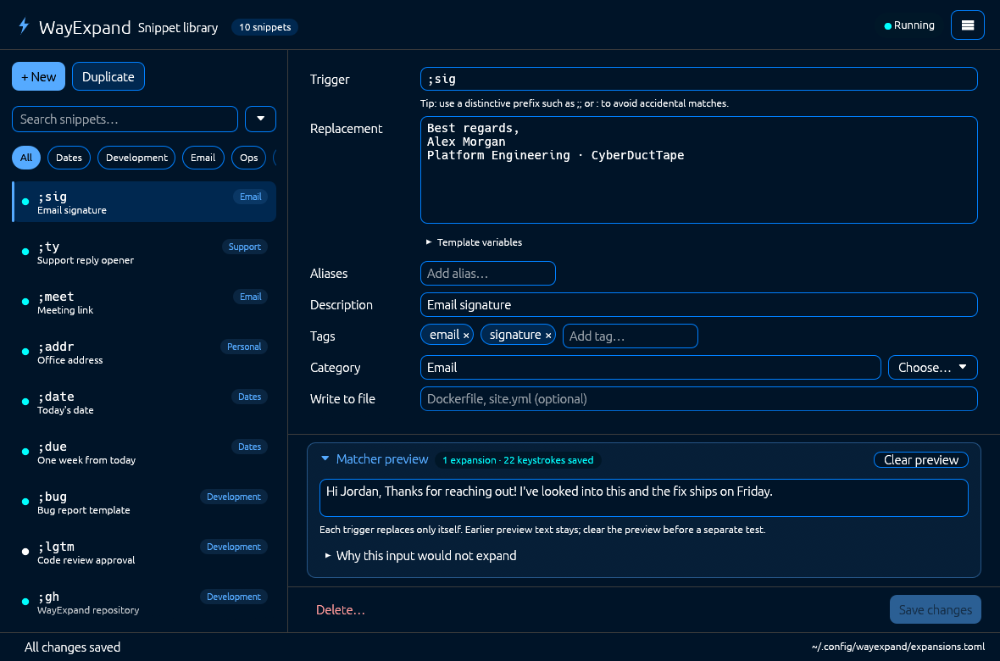
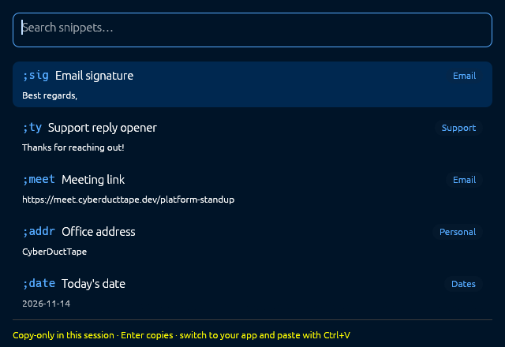
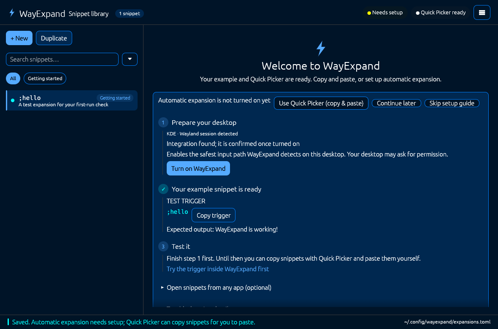

# WayExpand

[](https://github.com/cyberducttape/wayexpand/actions/workflows/ci.yml)
[](LICENSE)
[](https://www.rust-lang.org/)

## Type less. Keep your words local.

**WayExpand is a text expander built for Wayland.** Type `;sig` and get your
signature. Type `;ty` and get your support reply — with the cursor waiting
where you need to keep typing. Dates, addresses, templates, team snippets:
local, offline, no account, no telemetry.



### What makes it different

- **See it work before you set anything up.** The *Matcher preview* panel
  expands your saved snippets as you type with the daemon's own matching
  engine — no daemon, permission, or desktop integration needed — and counts
  the keystrokes you saved. It does not exercise desktop capture or insertion;
  `wayexpand doctor` explains the route's current readiness, while the GUI's
  *Test in a real application* flow is what checks visible insertion. A
  successful preview alone never means desktop expansion is working.
- **Quick-insert picker.** Press <kbd>Ctrl</kbd> + <kbd>Alt</kbd> +
  <kbd>Space</kbd> (set up by the first-run guide or `wayexpand shortcut set`
  on KDE Plasma and GNOME), type a few letters, and press Enter. No trigger to
  remember. The picker types the snippet into the app you came from only on a
  route that is atomic and identifies that exact window; none of today's
  standard routes combines both, so Enter usually copies the snippet for you to
  paste, even with the service running. The footer always says which.

  

- **Whole config files, filled in.** `wayexpand new playbook` asks for the
  host group and package and writes a ready Ansible playbook. Dockerfiles,
  Compose, Kubernetes, systemd units, nginx, and CI workflows are built in,
  and your own templates work the same way.
- **Guided setup.** The first-run guide detects your desktop, enables the
  safest input path it finds, and says what is missing when it cannot: a
  permission prompt, an IBus registration, or a logout on GNOME. It never
  grants raw keyboard access on its own.
- **Safe by design.** Matching pauses in password fields when the desktop
  reports them, app-specific snippets fail closed, command snippets run
  without a shell under timeouts and output limits, and errors never echo your
  snippet text.
- **Brings your library along.** Import Espanso YAML, edit in the GUI, the
  terminal UI, or plain TOML, and roll out team snippets with fleet policy.

### Project status at a glance

| Area | Current status |
| --- | --- |
| Configuration, CLI, and JSON contracts | Stable and regression-tested |
| Linux architectures | x86_64 and aarch64 build paths |
| Desktop integration | Wayland backends available; compositor support varies |
| Production certification | No compositor has accepted physical-session certification; see the [certification matrix](docs/CERTIFICATION_MATRIX.md) |
| Distribution packages | Prebuilt `.tar.gz`, `.deb` and `.rpm` with checksums on every GitHub release since 1.3.6; Ubuntu 26.04+ amd64 daily PPA; no Fedora Copr repository yet; certification pending |

## Install

| Your system | Install with |
| --- | --- |
| Debian, Ubuntu (amd64) | the `.deb` from the [latest GitHub release](https://github.com/cyberducttape/wayexpand/releases/latest) |
| Fedora and other RPM distributions (x86_64) | the `.rpm` from the [latest GitHub release](https://github.com/cyberducttape/wayexpand/releases/latest) |
| Any distribution, x86_64 or aarch64 | the [release archive](#release-archive) (`.tar.gz`), installed for your user |
| Ubuntu 26.04 or newer (amd64), daily builds | the [WayExpand PPA](#ubuntu-ppa) |
| Anything else, or to build it yourself | [a source build](#build-from-source), about five minutes |

<!-- generated-install-status:start -->
**Package availability (audited 2026-11-18):** GitHub release 1.3.6 has prebuilt binaries with checksums (`.tar.gz`, `.deb`, `.rpm`). PPA experimental daily builds for Ubuntu 26.04 (Resolute) (amd64), Ubuntu 26.10 (Stonking) (amd64). PPA packages for Ubuntu 24.04 (Noble) (0.2.0, stale), Ubuntu 22.04 (Jammy) (0.2.0, stale) lag behind; prefer the GitHub release there. Fedora Copr: not published yet. Package availability is separate from desktop certification.
<!-- generated-install-status:end -->

None of these channels is compositor-certified yet; see the
[packaging status](docs/PACKAGING.md) and the
[certification matrix](docs/CERTIFICATION_MATRIX.md).

### Desktop compatibility

Check the likely setup path for your desktop before choosing an integration:

| Desktop/session | Likely path | Evidence and limits |
| --- | --- | --- |
| GNOME Shell 46, 48, 50, or 51 | IBus with the WayExpand Shell extension | Headless integration-tested; no real GNOME session is production-certified. |
| GNOME Shell 49 | GNOME extension support is not declared | German and French layout switching has not been verified in a real GNOME 49 session. Do not treat the extension route as working; Quick Picker can copy snippets for manual paste. |
| Another GNOME Shell major | GNOME extension support is not declared | Compatibility is unknown. Check the setup guide before enabling an integration; Quick Picker can copy snippets for manual paste. |
| KDE Plasma / Wayland | Guided IBus setup; KWin tracking where available | Setup checks this session, but no route is production-certified. Verify in each target application. |
| Sway, Hyprland, or another Wayland desktop | Session-dependent or experimental route | Setup checks live capabilities. Use Quick Picker copy-and-paste if no route is available. |

On GNOME, check the installed Shell version with `gnome-shell --version` and
match it to the table before starting setup. Per-application GNOME results
across keyboard layouts are in the
[physical-session compatibility table](docs/GNOME_APPLICATION_COMPATIBILITY.md).
Recommended setup does not grant raw keyboard access. Treat any explicit evdev
request as a separate privacy choice; it observes keyboard events even in
password fields. See [sensitive-field limits](docs/BACKENDS_SENSITIVE_FIELDS.md).

### Release packages

Download the package and its `.sha256` from the
[latest release](https://github.com/cyberducttape/wayexpand/releases/latest),
then:

```sh
sha256sum --check wayexpand_*_amd64.deb.sha256 && sudo apt install ./wayexpand_*_amd64.deb   # Debian, Ubuntu
sha256sum --check wayexpand-*.x86_64.rpm.sha256 && sudo dnf install ./wayexpand-*.x86_64.rpm  # Fedora
```

Then launch **WayExpand** from the application menu; its guide finishes the
setup for your desktop.

### Ubuntu PPA

```sh
sudo add-apt-repository ppa:cyberducttape/ppa
sudo apt update
sudo apt install wayexpand
```

The PPA publishes experimental daily builds for Ubuntu 26.04 (Resolute) and
newer on amd64. Ubuntu 24.04 cannot be served yet because its archive has no
Rust 1.92; build from source there.

### Build from source

```sh
# 1. Native build tools (pick your distribution)
sudo apt install build-essential pkg-config libwayland-dev libxkbcommon-dev git   # Debian, Ubuntu
sudo dnf install gcc pkgconf-pkg-config wayland-devel libxkbcommon-devel git    # Fedora, RHEL-family
sudo pacman -S --needed base-devel wayland libxkbcommon git                       # Arch
sudo zypper install gcc pkg-config wayland-devel libxkbcommon-devel git         # openSUSE
sudo apk add build-base pkgconf wayland-dev libxkbcommon-dev git                # Alpine

# 2. Rust 1.92 or newer; skip if `cargo --version` already shows one.
#    Distribution Rust is often too old (Ubuntu 24.04 ships 1.75).
curl --proto '=https' --tlsv1.2 -sSf https://sh.rustup.rs | sh

# 3. Build and install for your user
git clone --depth 1 https://github.com/cyberducttape/wayexpand
cd wayexpand
./scripts/install-user.sh
"$HOME/.local/bin/wayexpand-gui"
```

The minimum supported Rust is 1.92 (`rust-version`, tested in CI). The
checkout also pins the toolchain it is developed and released with,
`rust-toolchain.toml` (currently 1.96.0), so under rustup the first build
downloads that toolchain. To build offline, run
`rustup toolchain install 1.96.0` while online first, or build with an
installed 1.92 or newer through `cargo +<version> build`.

### Release archive

```sh
sha256sum --check wayexpand-*-linux-x86_64.tar.gz.sha256
tar -xzf wayexpand-*-linux-x86_64.tar.gz
./wayexpand-*-linux-x86_64/scripts/install-release.sh
```

Before installing, the source and release installers show the desktop
compatibility summary and identify the active GNOME Shell version when
available, so you can see the likely route before continuing.

The release archive and source installer install for your user only. They never
run as root, enable services, grant raw-input access, or accept portal consent
for you. They stage the IBus component but may ask for administrator
authorization to register it system-wide, and on GNOME setup can ask you to log
out and back in before resuming.

### After installing

If your terminal says `wayexpand: command not found`, run the installed CLI
directly as `"$HOME/.local/bin/wayexpand"`, or add its directory to this
terminal's PATH with the command below; then the short-name examples later in
this guide will work in this terminal. If you keep PATH unchanged, prefix
each example with `"$HOME/.local/bin/wayexpand"` instead:

```sh
export PATH="$HOME/.local/bin:$PATH"
```

To keep that path in future terminals, run the one command for your shell
once: Bash, `printf '\nexport PATH="$HOME/.local/bin:$PATH"\n' >> "$HOME/.bashrc"`;
Zsh, `printf '\nexport PATH="$HOME/.local/bin:$PATH"\n' >> "$HOME/.zshrc"`;
Fish, `fish_add_path "$HOME/.local/bin"`.

Launch **WayExpand** from the desktop application menu or run `wayexpand-gui`.
For a per-user installation when `~/.local/bin` is not on PATH, run
`"$HOME/.local/bin/wayexpand-gui"`.
Its first-run guide checks the installation and route, then asks you to verify
an exact insertion in a real application before it records setup as working.
`wayexpand setup --check` reports missing integration dependencies without
enabling raw keyboard capture. If automatic expansion cannot be verified yet,
the guide offers a copy-only Quick Picker for manual paste.

## Your first minute



1. **Connect your desktop** — *Turn on WayExpand* in the GUI, or run
   `wayexpand setup` in a terminal. Setup configures the supported input route
   without manual IBus commands, and says what is missing if it cannot.
2. **Create a snippet** — *Create test snippet*, write your own, or import
   Espanso.
3. **Test it** — open a plain text field in another app, press *Test in a real
   application*, switch to that field and type the trigger once within 30
   seconds. WayExpand asks whether the text appeared correctly and records
   setup as working only when you confirm it. Until then, *Open Quick Picker*
   copies snippets for you to paste.
4. **Open snippets from any app** (optional) — the guide gives the Quick
   Picker a shortcut, <kbd>Ctrl</kbd> + <kbd>Alt</kbd> + <kbd>Space</kbd> unless
   that is taken. From a terminal: `wayexpand shortcut set [KEYS]`. On desktops
   other than KDE Plasma and GNOME, bind `wayexpand-gui --picker` in the
   keyboard settings. Scripts can insert directly with `wayexpand insert ';sig'`.

*Troubleshooting details* under the steps holds the route, permission and
certification notes, with *Open diagnostics* for the full report.

Useful commands:

```sh
wayexpand why              # the most likely cause, with one next step
wayexpand install-check    # are the installed files and integrations present?
wayexpand doctor           # is an input route available in this desktop session?
wayexpand debug            # detailed, content-free route diagnostics
wayexpand debug --test     # test a harmless expansion in a disposable text field
wayexpand test ';sig'      # check matching only; does not test desktop typing
```

If setup or expansion is stuck, start with `wayexpand why` and follow its
suggested next step. Use `wayexpand install-check` for an installation
problem, or `wayexpand doctor` for a desktop-session problem. After applying a
fix, run `wayexpand debug --test` in a disposable text field to check the
actual route. For the full symptom-by-symptom guide, see
[Troubleshooting](docs/TROUBLESHOOTING.md).

If you need to ask for help, open **Diagnostics → Export support report** to
preview the redacted report before saving it; GNOME sessions include GNOME
Shell, IBus source, and extension checks automatically. From a terminal, run
`wayexpand support-bundle --output wayexpand-support.json`; GNOME checks are
included automatically on GNOME. Use `--gnome` to request them on another
desktop. The report includes the likely cause and one suggested next action.
Review it before sharing.

For a sysadmin first task, see the [HTTP 503 incident triage
walkthrough](docs/HTTP503_WALKTHROUGH.md). It generates a validated,
review-first checklist for an explicitly selected local or remote shell
session; diagnostic commands are never run by WayExpand.

## Generate config files

Any snippet with an `output_file` is a file template. `wayexpand new` lists
them, asks for each `{{field:…}}` (in the terminal, or a form with `--gui`),
and writes the file without overwriting one that exists:

```console
$ wayexpand new compose --set service=web
Wrote compose.yaml
$ cat compose.yaml
services:
  web:
    image: nginx:stable
    restart: unless-stopped
    ports:
      - "8080:80"
    ...
```

Built in: `dockerfile` (plus `-python`, `-node`, `-rust`), `compose`,
`playbook`, `ansible-role`, `inventory`, `systemd-service`,
`github-actions`, `nginx-site`, and `k8s-deployment`. Start your own from
`wayexpand new --show playbook`. Jinja and GitHub `{{ … }}` expressions are
written as `{{{{ … }}}}`. See [Templates](docs/TEMPLATES.md).

## Compatibility limits

- **Committed text only.** WayExpand does not see IME preedit/composition;
  finish CJK, dead-key, and Compose sequences before expecting a trigger to
  match.
- **App-specific snippets** need focused-window tracking. It is implemented
  for KDE Plasma (KWin) and GNOME through the WayExpand Shell extension; GNOME
  tracking has headless integration coverage but is not yet production-
  certified in a real desktop session. Other desktops fail closed when a
  trustworthy tracker is unavailable.
- **No compositor has accepted physical-session production certification.**
  Headless CI and protocol tests do not establish physical-keyboard or
  real-session behavior. Run `wayexpand doctor` for local readiness, and
  consult the support and certification matrices before relying on a backend.
- **evdev is a last resort.** It observes every keyboard event, including
  password fields, so setup never grants keyboard-device access and
  keystroke routes keep typed expansions off until you allow them with
  `compatibility_mode`. Recommended mode configures the highest-ranked route
  that is available and allowed by policy: certified routes first, then
  input-method-v2 (when libei key pass-through is available), then IBus; it
  never automatically selects evdev or another globally observing path. See
  [Insertion guarantees](SECURITY.md#insertion-guarantees).

The [support matrix](docs/SUPPORT_MATRIX.md) and
[certification matrix](docs/CERTIFICATION_MATRIX.md) list evidence and known
limits; deployment teams should also use the
[production acceptance checklist](docs/PRODUCTION_ACCEPTANCE_CHECKLIST.md).

## Security

WayExpand runs as the unprivileged desktop user, works offline, has no
telemetry, and owner-checks its configuration files. Command snippets run
without a shell, with bounded queues, output limits, timeouts, and process
group cleanup; organization policy can audit or enforce restrictions. These
controls make everyday operation predictable — WayExpand does not claim to be
a security sandbox. See [SECURITY.md](SECURITY.md) and the
[threat model](THREAT_MODEL.md).

## Migrating from Espanso

```sh
wayexpand import espanso ~/.config/espanso > imported.toml
```

To add imported expansions directly to the active library, use `--add`:

```sh
wayexpand import autokey ~/.config/autokey/data/HotKeys --add --report-json
```

`--add` merges with the existing library, keeps existing trigger conflicts,
tests every added trigger and alias through the matcher and template renderer,
then saves atomically with a backup. Forms are checked for trigger recognition
but need user values; command-backed expansions are matched but never
executed; application filters are not tested without a focused window. A
failed validation or smoke test leaves the active library unchanged. Use
`--config PATH` with `--add` to target a different library.

`--strict` rejects entries whose Espanso semantics cannot be preserved, and
`--report-json` writes a machine-readable migration report to stderr. Directory
imports include nested match files. Supported dynamic variables and basic
forms are converted; shell/script and clipboard execution or access are not
enabled implicitly. The GUI's import merges by default and previews conflicts
before anything changes. See [Migrating from Espanso](docs/MIGRATION_FROM_ESPANSO.md).

Static AutoKey phrases can be imported from their `.txt` and JSON sidecar
tree. Scripts, hotkeys, filters, and dynamic macros are reported as
unsupported and never run during import. See
[Migrating from AutoKey](docs/MIGRATION_FROM_AUTOKEY.md).

## Configuration profiles

Keep separate personal, work, or customer libraries and switch between them:

```bash
wayexpand profile create personal
wayexpand profile create work
wayexpand profile switch personal
wayexpand profile list
```

Each profile stores a validated configuration snapshot beside the active
configuration. Switching checkpoints edits to the outgoing profile, validates
the selected configuration with shared `snippets.d` layers, replaces the
active config atomically, and asks the daemon to reload. Assign exact desktop
application IDs with `wayexpand profile assign-app <app-id> <profile>`;
matching pauses while a newly focused app's library loads. See the
[profile guide](docs/PROFILES.md) and [Operations](docs/OPERATIONS.md#configuration-profiles).

## Documentation

- [Getting started](docs/GETTING_STARTED.md) · [Troubleshooting](docs/TROUBLESHOOTING.md)
- [Templates](docs/TEMPLATES.md) · [GUI](docs/GUI.md)
- [Backends](docs/BACKENDS.md) · [Support matrix](docs/SUPPORT_MATRIX.md)
- [Fleet deployment](docs/FLEET_CONFIG.md) · [For sysadmins](docs/FOR_SYSADMINS.md)
- [Safety-aware workflows](docs/SAFE_WORKFLOWS.md)
- [Packaging](docs/PACKAGING.md) · [Roadmap](docs/ROADMAP.md)
- [Everything else](docs/DOCUMENTATION_INDEX.md)

Non-English documentation: [Deutsch](README.de.md).

## Contributing

See [CONTRIBUTING.md](CONTRIBUTING.md) for the development setup, PR checklist,
and project structure. CI runs formatting, tests, Clippy, shellcheck, installer
checks, systemd validation, packaging checks, and dependency advisories.

## License

[MIT](LICENSE). WayExpand is built and maintained by
[CyberDuctTape](https://github.com/cyberducttape).
