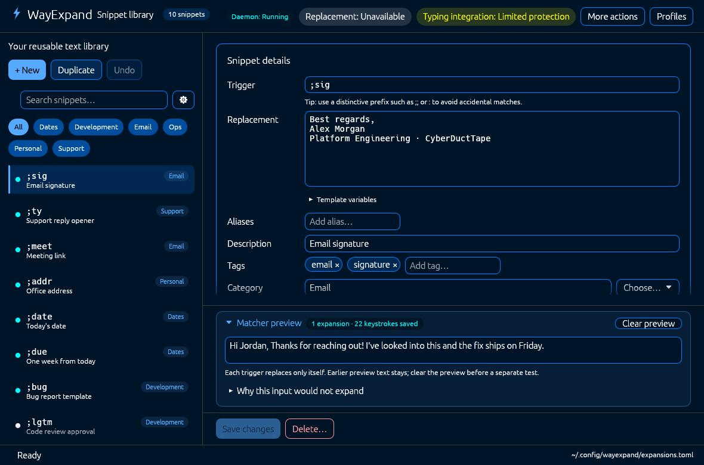
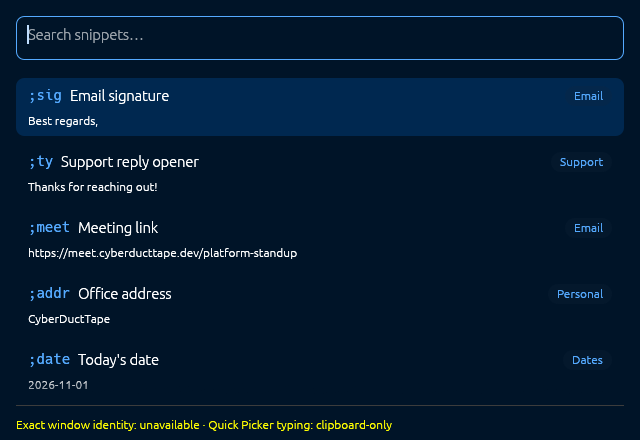
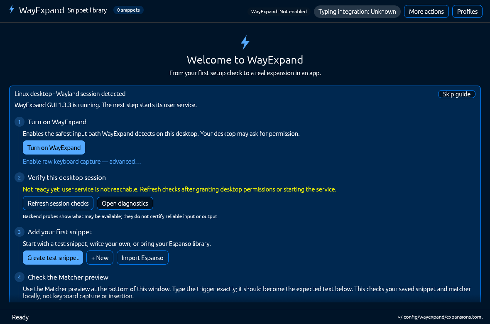

# WayExpand

[](https://github.com/cyberducttape/wayexpand/actions/workflows/ci.yml)
[](LICENSE)
[](https://www.rust-lang.org/)

## Type less. Keep your words local.

**WayExpand is a text expander built for Wayland.** Type `;sig` and get your
signature. Type `;ty` and get your support reply — with the cursor waiting
where you need to keep typing. Dates, addresses, templates, team snippets:
local, offline, no account, no telemetry.



### What makes it different

- **See it work before you set anything up.** The *Matcher preview* panel
  expands your saved snippets as you type with the daemon's own matching
  engine — no daemon, permission, or desktop integration needed — and counts
  the keystrokes you saved. It does not exercise desktop capture or insertion;
  `wayexpand doctor` covers that.
- **Quick-insert picker.** Bind `wayexpand-gui --picker` to a keyboard
  shortcut. Type a few letters, press Enter, and the running WayExpand service
  types the snippet into the app you were using. Typing needs focused-window
  tracking (currently KDE Plasma); elsewhere, or without the service, Enter
  copies it to the clipboard. No trigger to remember.

  

- **Whole config files, filled in.** `wayexpand new playbook` asks for the
  host group and package and writes a ready Ansible playbook. Dockerfiles,
  Compose, Kubernetes, systemd units, nginx, and CI workflows are built in,
  and your own templates work the same way.
- **One click to turn on.** The first-run screen detects your desktop and
  enables the safest input path it finds. It never grants raw keyboard access
  on its own.
- **Safe by design.** Matching pauses in password fields when the desktop
  reports them, app-specific snippets fail closed, command snippets run
  without a shell under timeouts and output limits, and errors never echo your
  snippet text.
- **Brings your library along.** Import Espanso YAML, edit in the GUI, the
  terminal UI, or plain TOML, and roll out team snippets with fleet policy.

### Project status at a glance

| Area | Current status |
| --- | --- |
| Configuration, CLI, and JSON contracts | Stable and regression-tested |
| Linux architectures | x86_64 and aarch64 build paths |
| Desktop integration | Wayland backends available; compositor support varies |
| Production certification | No compositor has accepted physical-session certification; see the [certification matrix](docs/CERTIFICATION_MATRIX.md) |
| Distribution packages | Ubuntu 26.04+ amd64 daily PPA package; release binaries for every distribution from the next GitHub release; no Fedora Copr repository yet; certification pending |

## Install

| Your system | Install with |
| --- | --- |
| Ubuntu 26.04 or newer (amd64) | the [WayExpand PPA](#ubuntu-ppa) |
| Any other Linux distribution | [a source build](#build-from-source), about five minutes |
| Any distribution, no compiler | the `.tar.gz`, `.deb` or `.rpm` attached to a [GitHub release](https://github.com/cyberducttape/wayexpand/releases) or *Experimental build* prerelease; release 1.3.3 has none attached |

None of these channels is compositor-certified yet; see the
[packaging status](docs/PACKAGING.md) and the
[certification matrix](docs/CERTIFICATION_MATRIX.md).

### Ubuntu PPA

```sh
sudo add-apt-repository ppa:cyberducttape/ppa
sudo apt update
sudo apt install wayexpand
```

The PPA publishes experimental daily builds for Ubuntu 26.04 (Resolute) and
newer on amd64. Ubuntu 24.04 cannot be served yet because its archive has no
Rust 1.92; build from source there.

### Build from source

```sh
# 1. Native build tools (pick your distribution)
sudo apt install build-essential pkg-config libwayland-dev libxkbcommon-dev git   # Debian, Ubuntu
sudo dnf install gcc pkgconf-pkg-config wayland-devel libxkbcommon-devel git      # Fedora
sudo pacman -S --needed base-devel wayland libxkbcommon git                       # Arch

# 2. Rust 1.92 or newer; skip if `cargo --version` already shows one.
#    Distribution Rust is often too old (Ubuntu 24.04 ships 1.75).
curl --proto '=https' --tlsv1.2 -sSf https://sh.rustup.rs | sh

# 3. Build and install for your user
git clone --depth 1 https://github.com/cyberducttape/wayexpand
cd wayexpand
./scripts/install-user.sh
wayexpand-gui
```

### Release archive

```sh
sha256sum --check wayexpand-*-linux-x86_64.tar.gz.sha256
tar -xzf wayexpand-*-linux-x86_64.tar.gz
./wayexpand-*-linux-x86_64/scripts/install-release.sh
```

The release archive and source installer install for your user only. They never
run as root, enable services, grant raw-input access, or accept portal consent
for you. They stage the IBus component but may ask for administrator
authorization to register it system-wide, and on GNOME setup can ask you to log
out and back in before resuming.

### After installing

Launch **WayExpand** from the desktop application menu or run `wayexpand-gui`.
Its first-run guide checks the installation and route, then asks you to verify
an exact insertion in a real application before it records setup as working.
`wayexpand setup --check` reports missing integration dependencies without
enabling raw keyboard capture. If automatic expansion cannot be verified yet,
the guide offers a copy-only Quick Picker for manual paste.

## Your first minute



1. **Turn on WayExpand** — one click in the GUI, or `wayexpand setup` in a
   terminal. Setup configures the supported input route without requiring
   manual IBus commands.
2. **Verify this desktop session** — setup guides you through a harmless real
   application insertion and ends as Working, Configured awaiting test, or
   Action required. The GUI's *Open diagnostics* shows route capabilities and
   certification separately.
3. **Add a snippet** — *Create test snippet*, write your own, or import Espanso.
4. **Try it** — type the trigger in *Matcher preview*, then in a normal text
   field in an app you use.

Set up the picker by adding a desktop shortcut (for example <kbd>Super</kbd> +
<kbd>.</kbd>) that runs `wayexpand-gui --picker`. Scripts can do the same with
`wayexpand insert ';sig'`.

Useful commands:

```sh
wayexpand doctor          # what this desktop supports, and what is missing
wayexpand status          # is the daemon running, and on which path
wayexpand upgrade-status  # is the running daemon from this CLI build?
wayexpand test ';sig'     # check matching without the desktop
```

For a sysadmin first task, see the [HTTP 503 incident triage
walkthrough](docs/HTTP503_WALKTHROUGH.md). It generates a validated,
review-first checklist for an explicitly selected local or remote shell
session; diagnostic commands are never run by WayExpand.

## Generate config files

Any snippet with an `output_file` is a file template. `wayexpand new` lists
them, asks for each `{{field:…}}` (in the terminal, or a form with `--gui`),
and writes the file without overwriting one that exists:

```console
$ wayexpand new compose --set service=web
Wrote compose.yaml
$ cat compose.yaml
services:
  web:
    image: nginx:stable
    restart: unless-stopped
    ports:
      - "8080:80"
    ...
```

Built in: `dockerfile` (plus `-python`, `-node`, `-rust`), `compose`,
`playbook`, `ansible-role`, `inventory`, `systemd-service`,
`github-actions`, `nginx-site`, and `k8s-deployment`. Start your own from
`wayexpand new --show playbook`. Jinja and GitHub `{{ … }}` expressions are
written as `{{{{ … }}}}`. See [Templates](docs/TEMPLATES.md).

## Desktop compatibility

- **Committed text only.** WayExpand does not see IME preedit/composition;
  finish CJK, dead-key, and Compose sequences before expecting a trigger to
  match.
- **App-specific snippets** need focused-window tracking. It is implemented
  for KDE Plasma (KWin) and GNOME through the WayExpand Shell extension; GNOME
  tracking has headless integration coverage but is not yet production-
  certified in a real desktop session. Other desktops fail closed when a
  trustworthy tracker is unavailable.
- **No compositor has accepted physical-session production certification.**
  Headless CI and protocol tests do not establish physical-keyboard or
  real-session behavior. Run `wayexpand doctor` for local readiness, and
  consult the support and certification matrices before relying on a backend.
- **evdev is a last resort.** It observes every keyboard event, including
  password fields, so setup never grants keyboard-device access and
  keystroke routes keep typed expansions off until you allow them with
  `compatibility_mode`. Recommended mode configures the highest-ranked route
  that is available and allowed by policy: certified routes first, then
  input-method-v2 (when libei key pass-through is available), then IBus; it
  never automatically selects evdev or another globally observing path. See
  [Insertion guarantees](SECURITY.md#insertion-guarantees).

The [support matrix](docs/SUPPORT_MATRIX.md) and
[certification matrix](docs/CERTIFICATION_MATRIX.md) list evidence and known
limits; deployment teams should also use the
[production acceptance checklist](docs/PRODUCTION_ACCEPTANCE_CHECKLIST.md).

## Security

WayExpand runs as the unprivileged desktop user, works offline, has no
telemetry, and owner-checks its configuration files. Command snippets run
without a shell, with bounded queues, output limits, timeouts, and process
group cleanup; organization policy can audit or enforce restrictions. These
controls make everyday operation predictable — WayExpand does not claim to be
a security sandbox. See [SECURITY.md](SECURITY.md) and the
[threat model](THREAT_MODEL.md).

## Migrating from Espanso

```sh
wayexpand import espanso ~/.config/espanso > imported.toml
```

To add imported expansions directly to the active library, use `--add`:

```sh
wayexpand import autokey ~/.config/autokey/data/HotKeys --add --report-json
```

`--add` merges with the existing library, keeps existing trigger conflicts,
tests every added trigger and alias through the matcher and template renderer,
then saves atomically with a backup. Forms are checked for trigger recognition
but need user values; command-backed expansions are matched but never
executed; application filters are not tested without a focused window. A
failed validation or smoke test leaves the active library unchanged. Use
`--config PATH` with `--add` to target a different library.

`--strict` rejects entries whose Espanso semantics cannot be preserved, and
`--report-json` writes a machine-readable migration report to stderr. Directory
imports include nested match files. Supported dynamic variables and basic
forms are converted; shell/script and clipboard execution or access are not
enabled implicitly. The GUI's import merges by default and previews conflicts
before anything changes. See [Migrating from Espanso](docs/MIGRATION_FROM_ESPANSO.md).

Static AutoKey phrases can be imported from their `.txt` and JSON sidecar
tree. Scripts, hotkeys, filters, and dynamic macros are reported as
unsupported and never run during import. See
[Migrating from AutoKey](docs/MIGRATION_FROM_AUTOKEY.md).

## Configuration profiles

Keep separate personal, work, or customer libraries and switch between them:

```bash
wayexpand profile create personal
wayexpand profile create work
wayexpand profile switch personal
wayexpand profile list
```

Each profile stores a validated configuration snapshot beside the active
configuration. Switching checkpoints edits to the outgoing profile, validates
the selected configuration with shared `snippets.d` layers, replaces the
active config atomically, and asks the daemon to reload. Assign exact desktop
application IDs with `wayexpand profile assign-app <app-id> <profile>`;
matching pauses while a newly focused app's library loads. See the
[profile guide](docs/PROFILES.md) and [Operations](docs/OPERATIONS.md#configuration-profiles).

## Documentation

- [Getting started](docs/GETTING_STARTED.md) · [Troubleshooting](docs/TROUBLESHOOTING.md)
- [Templates](docs/TEMPLATES.md) · [GUI](docs/GUI.md)
- [Backends](docs/BACKENDS.md) · [Support matrix](docs/SUPPORT_MATRIX.md)
- [Fleet deployment](docs/FLEET_CONFIG.md) · [For sysadmins](docs/FOR_SYSADMINS.md)
- [Safety-aware workflows](docs/SAFE_WORKFLOWS.md)
- [Packaging](docs/PACKAGING.md) · [Roadmap](docs/ROADMAP.md)
- [Everything else](docs/DOCUMENTATION_INDEX.md)

Non-English documentation: [Deutsch](README.de.md).

## Contributing

See [CONTRIBUTING.md](CONTRIBUTING.md) for the development setup, PR checklist,
and project structure. CI runs formatting, tests, Clippy, shellcheck, installer
checks, systemd validation, packaging checks, and dependency advisories.

## License

[MIT](LICENSE). WayExpand is built and maintained by
[CyberDuctTape](https://github.com/cyberducttape).
